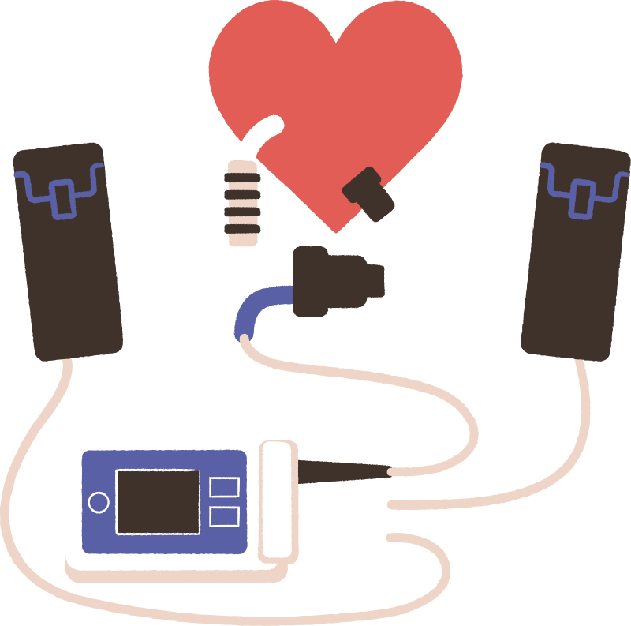
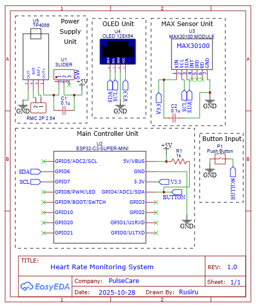
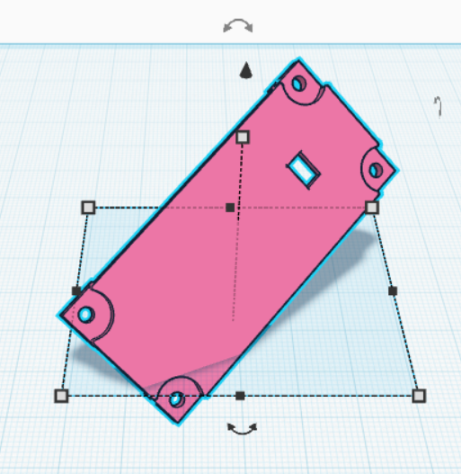
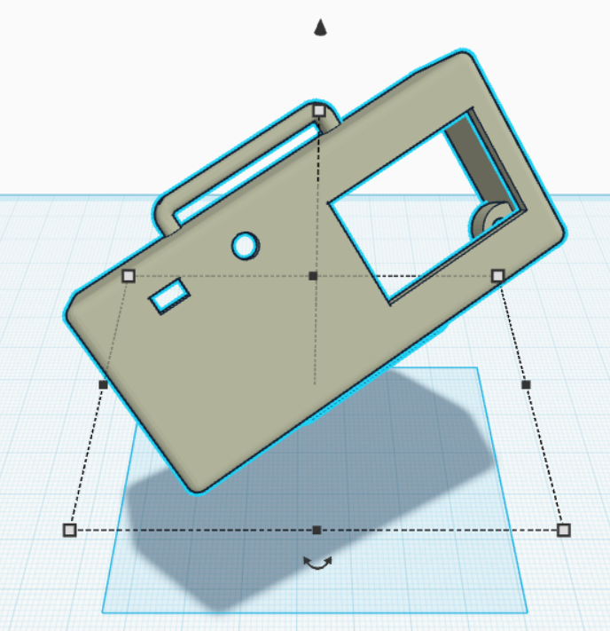

<p align="center">
  
</p>

<h1 align="center">PulseCare</h1>
<p align="center"><b>A BLE-connected wearable that monitors heart rate and SpO₂ and lets a guardian follow a patient remotely</b></p>
<p align="center"><i>"Peace of Mind, Every Beat"</i></p>

<p align="center">
  
  
  
  
  
  
</p>

---

## Overview

PulseCare is an end-to-end IoT health-monitoring prototype that covers **embedded firmware, wireless communication, a mobile app, a cloud backend, and a custom 3D-printed enclosure**. A wrist-worn device measures heart rate and blood-oxygen saturation, shows the readings on an OLED display, and streams them over Bluetooth Low Energy to an Android app. The app syncs the data to Cloud Firestore so a guardian can follow the patient in real time, and a long press on the device's button sends an emergency SOS alert.

It was designed and built by a team of three as a semester project at the **Department of Electrical and Electronic Engineering, University of Peradeniya**.

<p align="center">
  
</p>

## The Problem: the cardiac care gap

- **Doctors only see patient data during hospital visits.** Between visits, there is no continuous view of the patient's condition.
- **Care is reactive.** It often depends on patients reporting symptoms after they happen, rather than collecting data that could help prevent an incident.
- **Patients feel isolated.** High-risk patients recovering at home can feel anxious and disconnected from medical support.

## The Solution

A compact wrist-worn device that **continuously tracks heart rate and SpO₂** and links the patient with a guardian over BLE.

| Value | What it means |
|---|---|
| **Continuous monitoring** | Non-invasive tracking of vital signs throughout the day |
| **Instant alerts** | A dedicated SOS button for immediate help |
| **Remote connectivity** | Data synced to a mobile app and the cloud, so guardians stay informed |

## System Architecture

```
   INPUT                  PROCESS                OUTPUT                 RECEIVER
┌───────────────────┐   ┌────────────────┐   ┌─────────────────┐   ┌──────────────────────┐
│ MAX30100 sensor   │──▶│   ESP32-C3     │──▶│ 0.96" OLED      │   │ Android app          │
│ (PPG: HR + SpO₂)  │   │   Super Mini   │   │ display         │   │   │                  │
│                   │   │                │   │                 │   │   ▼                  │
│ Push button       │──▶│ Sampling,      │──▶│ BLE transmit    │──▶│ Cloud Firestore      │
│ (screen / SOS)    │   │ averaging, UI  │   │                 │   │   │                  │
└───────────────────┘   └────────────────┘   └─────────────────┘   │   ▼                  │
                                                                   │ Guardian alerts +    │
                                                                   │ web portal           │
                                                                   └──────────────────────┘
```

### White-Box Analysis (power and data flow)

```
3.7 V Li-Po battery ──▶ TP4056 charger IC ──▶ ESP32-C3 Super Mini ◀──▶ MAX30100 module   (I2C)
                                                      ├───▶ 0.96" OLED display  (I2C)
                                                      └───▶ BLE transmit
```

## Hardware

| Component | Role |
|---|---|
| **ESP32-C3 Super Mini** | Main controller with built-in BLE, chosen for its small size and low power use |
| **MAX30100** | Pulse oximeter and heart-rate sensor (PPG) |
| **0.96" OLED (128×64, SSD1306)** | On-device display for vitals and time |
| **3.7 V Li-Po battery + TP4056** | Rechargeable power supply and charging circuit |
| **Push button** | Switches screens and triggers SOS |
| **3D-printed enclosure** | Custom wrist-worn housing |

### Schematic

The circuit is split into four blocks: **power supply, main controller, OLED, and sensor**, plus the button input. It was drawn in EasyEDA.

<p align="center">
  
</p>

| Signal | ESP32-C3 pin |
|---|---|
| I2C SDA (shared by MAX30100 and OLED) | GPIO 6 |
| I2C SCL (shared by MAX30100 and OLED) | GPIO 7 |
| Push button (active-low, internal pull-up) | GPIO 4 |

### Enclosure Design

A custom two-part enclosure was modelled in 3D and printed to hold the board, battery, sensor window, display cut-out and button.

<p align="center">
  
  &nbsp;&nbsp;
  
</p>

## Firmware Highlights

The firmware ([`Code/watch.ino`](Code/watch.ino)) is non-blocking and built around `millis()`-based timers, so sensing, display, BLE and button handling all run together without `delay()` in the main loop.

| Task | Rate |
|---|---|
| Sensor sampling | Every 50 ms |
| Screen refresh | Every 100 ms |
| BLE update (averaged values) | Every 2 s |
| Software clock tick | Every 1 s |

**On-device features**

- **Vitals screen:** heart rate and SpO₂, with a heart icon that blinks on each detected beat (beat-detection callback)
- **Clock screen:** time and date, synced from the phone over BLE, with a seconds progress bar
- **One-button interface:**
  - Short press (< 0.6 s): switch between vitals and clock
  - Long press (> 2 s): send an **SOS** alert and show an on-screen confirmation
- **Robust startup:** retries the sensor connection up to five times and shows a clear error if it isn't found
- **Branded boot sequence:** heartbeat animation followed by the logo and motto

### BLE GATT Design

The device advertises as **`PulseCare`** with a custom service (`ABF0`):

| Characteristic | UUID | Property | Payload |
|---|---|---|---|
| Vitals | `ABF2` | Notify | 2 bytes: `[heart rate (BPM), SpO₂ (%)]` |
| SOS | `ABF1` | Notify | `"SOS"` when the long press is detected |
| Time sync | `ABF3` | Write | `HH:MM:SS,DD/MM/YYYY` written by the phone |

The device restarts advertising automatically when the phone disconnects, so it can reconnect without a reset.

## Mobile App and Cloud

- **Android app (Flutter/Dart):** connects to the device over BLE and provides separate **patient** and **guardian** views.
- **Cloud Firestore:** stores readings as timestamped records and handles live syncing to the guardian.
- **SOS flow:** button long-press → BLE notification → app → Firestore → guardian alerted.

> The Flutter source code was lost due to a hardware failure on the development machine. The compiled app is still available: download **`app-release.apk`** from the **[Releases](../../releases)** page and install it on an Android phone.

## Health Background

| Measurement | How it's measured | Normal range | Concern |
|---|---|---|---|
| **Heart rate** | Photoplethysmography (PPG) detects blood-volume changes in the tissue | 60–100 BPM at rest | Spikes (tachycardia) or drops (bradycardia) |
| **SpO₂** | Ratio of red and infrared light absorption by oxygenated vs. deoxygenated haemoglobin | 95–100 % | Below 90 % indicates hypoxia |

## Known Limitations and Next Steps

This is a working prototype, and the current firmware is tuned for live demonstrations:

- Real readings are **constrained to a normal range** (60–90 BPM, 95–99 % SpO₂) to smooth out the MAX30100's noisy output, so abnormal values are not yet reported.
- When no finger is detected for 6 seconds, the device switches to a **demo mode** with simulated values.

**Planned improvements**

- Replace the range clamping with proper signal filtering so abnormal readings can trigger automatic alerts
- Upgrade to the more accurate **MAX30102** sensor
- Add battery-level monitoring and low-power sleep modes
- Rebuild and open-source the mobile app

> PulseCare is a student prototype, not a certified medical device.

## Getting Started

1. Install the **ESP32 board package** (by Espressif) in the Arduino IDE.
2. Install these libraries from the Library Manager: **MAX30100lib** (OXullo Intersecans), **Adafruit GFX Library**, and **Adafruit SSD1306**.
3. Open `Code/watch.ino`, select an **ESP32C3** board, and enable **USB CDC On Boot**.
4. Upload, and open the Serial Monitor at **115200 baud**.
5. Install the APK from Releases, place a finger on the sensor, and connect from the app.

## Repository Structure

```
├── Code/
│   └── watch.ino          # ESP32-C3 firmware: sensing, OLED UI, BLE, SOS
├── Documentation/
│   └── PulseCare.pdf      # Project presentation
├── Images/                # Logo, schematic and enclosure renders
└── README.md
```

## Team

Department of Electrical and Electronic Engineering, University of Peradeniya, Sri Lanka

| Name | Reg. No. |
|---|---|
| Karunaratne A.G.S.I. | E/20/192 |
| Wahalathantri T.N. | E/20/418 |
| Wickramasinghe R.T. | E/20/440 |
